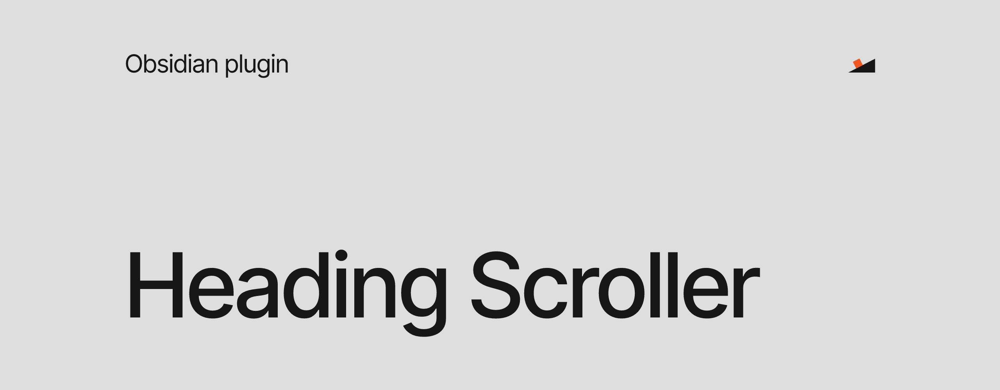
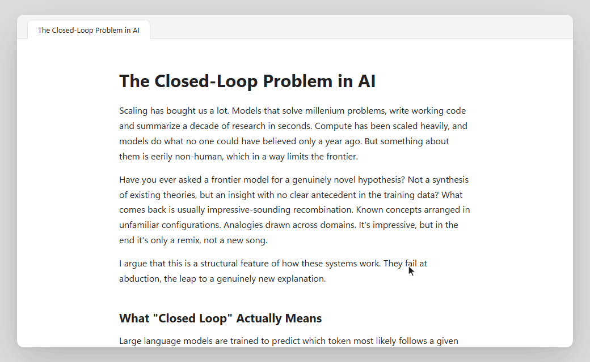

Long notes are hard to move around in. You scroll up to check what a section was called, lose your place and scroll back down again. Obsidian has an outline view for this, but it lives in the sidebar, and the sidebar is closed most of the time.

Heading Scroller puts a thin rail at the edge of the note, with one tick for each heading. The tick of the section you are reading is darker than the others, so you always know where you are. When you need more than that, move the pointer onto the rail and it opens into the full outline. Click a heading and you are there. Most of the time you won't notice the rail at all, which is exactly the idea.



## How it works

The rail appears in every note with at least two headings. Longer ticks stand for higher headings, so the rail also gives you a rough picture of how the note is built before you read it. Click a tick to jump to its heading, or hover over the rail to see every heading by name.

On a phone or tablet, the first tap opens the outline and the second one takes you to the heading. You can move the rail to the right edge in **Settings → Heading Scroller**. If your system asks for reduced motion, the rail stops animating and jumps instead of scrolling.

## Install

1. In Obsidian, open **Settings → Community plugins → Browse**.
2. Search for **Heading Scroller**.
3. Select **Install**, then **Enable**.

To install it by hand, download `main.js`, `manifest.json` and `styles.css` from the [latest release](../../releases/latest) into `.obsidian/plugins/heading-scroller/` in your vault, then reload Obsidian.

## Privacy

Everything happens inside Obsidian. The plugin makes no network requests, collects no data and does not read files outside your vault.

## Build it yourself

```bash
corepack enable
pnpm install
pnpm check
```

`pnpm check` runs the formatter check, the tests and the production build.

## License

[MIT](LICENSE)

PS: The note in the demo is my essay [The Closed-Loop Problem in AI](https://readfriction.substack.com/p/the-closed-loop-problem-in-ai). I write about taste, agency and what AI does to both on [friction](https://readfriction.substack.com).
